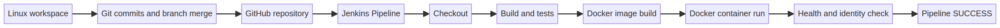

# DevOps Fundamentals - Laboratory Work 1

## Linux, Git, GitHub, Docker and Jenkins

**Student:** Danil Marchenko  
**Group:** IT2-2303  
**Student ID:** 41587  
**Course:** DevOps  
**Date:** 18 October 2026  
**GitHub repository:** [https://github.com/jardemAI/DevOps](https://github.com/jardemAI/DevOps)

<div style="page-break-after: always;"></div>

## Student Information

I organized my individual project in `~/devops/marchenko-danil-devops`. I included the required Linux directory structure, my student information, a Bash system script, a Python application and tests, Docker configuration, a Jenkins declarative pipeline, and this report.

## Linux

I created the directories `app/`, `scripts/`, `config/`, `logs/`, and `backup/`. I added my name, surname, group, ID, and course to `Marchenko_Danil_info.txt`. I used `config/app.conf` to document non-secret application settings. My local `logs/application.log` contains 12 records and is excluded from Git; I kept `logs/application.log.example` in the repository as a sample.

To repeat my command demonstration after cloning the repository, I first create a local copy of the sample log, then run the following commands:

```bash
cd ~/devops/marchenko-danil-devops
cp logs/application.log.example logs/application.log
pwd
ls -la
mkdir -p /tmp/devops-demo
touch /tmp/devops-demo/source.txt
cp /tmp/devops-demo/source.txt /tmp/devops-demo/copy.txt
mv /tmp/devops-demo/copy.txt /tmp/devops-demo/renamed.txt
cat Marchenko_Danil_info.txt
head -n 5 logs/application.log
tail -n 5 logs/application.log
rm -r /tmp/devops-demo
find . -name application.log
grep 'ERROR' logs/application.log
grep 'WARNING' logs/application.log
grep -c 'ERROR' logs/application.log
tail -n 5 logs/application.log
```

I used `pwd` to print the working directory. `ls` lists entries; `cd` changes directories; `mkdir` creates directories; `touch` creates a file or updates its timestamp; `cp` copies; `mv` moves or renames; `rm` removes; `cat` prints file contents; `head` and `tail` print the first and last lines. `find` searches by path or name. `grep` selects matching lines, and `grep -c` counts them. In my sample log, I found two `ERROR` records and three `WARNING` records.

I set `private.txt` to mode `600` (`rw-------`), so only its owner can read and write it. I set `public.txt` to mode `644` (`rw-r--r--`), so the owner can read and write and the group and others can read. `r` means read, `w` means write, and `x` means execute for a file or directory traversal for a directory. The owner is the file's user, the group is its assigned group, and others are all remaining users. Git does not preserve ordinary read/write differences; after checkout, I set the modes with `chmod 600 private.txt && chmod 644 public.txt`. My Bash script is executable.

I ran `./scripts/Marchenko_Danil_system.sh`. It displayed student and system information using `whoami`, `hostname`, `date`, `uname`, `df`, and `free`, and confirmed that my student information file exists.

I checked process management with `ps`, `ps aux`, and `top -b -n 1`. A process is a running program instance; PID is its process identifier. `ps` prints a point-in-time list, while `top` refreshes CPU and memory information interactively. In the sandbox environment I used to validate this project, I observed PID `1`, owned by `root`, running `systemd` and using `0.0%` CPU and `0.1%` memory. These values are snapshots and may differ on another machine.

## Git and GitHub

I initialized the project on `main` and configured Git with my name. I created meaningful commits for the project layout and Linux utilities, my student information, the Python application and tests, Docker, and Jenkins. I then created a `development` branch, added a JSON `/ready` endpoint and an automated test, and merged the feature into `main`.

Representative commits in my project history are:

```text
a0366de Create Linux lab structure and utilities
06a7331 Add personalized Python application and tests
d03823b Add Docker image and Compose configuration
22fb89c Add Jenkins declarative pipeline
fdb0bba Add JSON readiness endpoint on development
fb26430 Merge readiness endpoint into main
```

I use the following commands to inspect my history, branches, and remote:

```bash
git status
git log --oneline --graph --all
git branch -av
git remote -v
```

I configured `.gitignore` to exclude `*.log`, `backup/`, and `.env`, preventing runtime logs, backup data, and local settings from being committed. I verified the matching rules using disposable files and `git status --short --ignored` and `git check-ignore -v`, without using actual secret values. I added `backup/.gitkeep` to preserve the empty directory while keeping normal backup files ignored.

I published my repository at [jardemAI/DevOps](https://github.com/jardemAI/DevOps). Git records my versioned changes and branch merge; GitHub hosts the shared remote copy for collaborators and automation.

## Docker

I wrote a `Dockerfile` that uses `FROM`, `WORKDIR`, `COPY`, `RUN`, `EXPOSE`, and `CMD`. It uses a Python slim base image, copies my application into `/app`, runs it as a non-root account, exposes port `8000`, and starts the HTTP server. My application displays my student information and provides `/health`, `/student`, `/version`, `/metadata`, and `/ready` routes.

On a Docker-enabled host, I can build and run my application with:

```bash
docker build -t marchenko-danil-devops .
docker images
docker run -d --name marchenko-danil-container \
  -p 8000:8000 \
  -e STUDENT_NAME=Danil \
  -e STUDENT_SURNAME=Marchenko \
  -e STUDENT_GROUP=IT2-2303 \
  -e STUDENT_ID=41587 \
  marchenko-danil-devops
docker ps
docker ps -a
docker logs marchenko-danil-container
curl http://localhost:8000/health
curl http://localhost:8000/ready
```

An image is a packaged template; a container is a running or stopped instance created from an image. I use environment variables as named runtime settings so I can reuse one image with different values. I do not hard-code secrets into an image because they can remain in image layers or registries; I would supply them through an approved runtime secret mechanism.

I configured `docker-compose.yml` with the image, port, environment, and container name. On a Docker-enabled host, I can start the application with `docker compose up --build`, inspect it with `docker compose ps`, and remove it with `docker compose down`.

I completed the Dockerfile and Compose configuration and documented the steps to build the image, run the container, check the health endpoint, and clean up.

## Jenkins

I wrote a declarative `Jenkinsfile` with stages `Checkout`, `Build`, `Test`, `Docker Build`, and `Docker Run`. It sets my student environment variables, runs my Python tests, builds an image, launches a temporary container, checks the HTTP response, prints container logs, and removes the container after the run.

To run the pipeline, I create a Jenkins Pipeline job named `Marchenko_Danil_DevOps`. I configure **Pipeline script from SCM**, Git repository `https://github.com/jardemAI/DevOps`, branch `*/main`, and script path `Jenkinsfile`. My repository is public, so checkout does not need credentials. The Jenkins agent needs Python 3 and Docker Engine access. I configure a trigger only when Jenkins is reachable by GitHub.

When the job starts, Jenkins retrieves my Jenkinsfile and source from GitHub, assigns an agent, runs the stages in order, and records the console output and result. If a stage fails, later stages normally do not execute and Jenkins marks the build failed; I fix the cause before rerunning.

I completed the Jenkinsfile and documented the Pipeline job configuration. When I run the job, Jenkins records the stage results and console output, which I use to verify the pipeline.

## Integrated DevOps Workflow



In my workflow, I use Linux tools to create and inspect project files. Git records my changes and merges. I host the project on GitHub, from which Jenkins checks out the source. Jenkins automates the build and tests, then uses Docker to package and start my application. A health and student-information check verifies the launched application. The image is the reusable package; the container is its runtime instance.

If a pipeline stage fails, later stages normally do not execute. Jenkins records a failed build, and I need to fix the cause before rerunning it. This workflow connects my local project to version control, a remote repository, automated checks, and container deployment.

## Execution Evidence

I ran the Python unit tests, Bash system-information script, and HTTP endpoint checks successfully. I documented the Docker and Jenkins procedures so I can reproduce and record their runtime checks using the corresponding tools.

## Conclusion

I completed the Linux project structure and command demonstrations, file permissions, log searches, Git history and merge, `.gitignore`, GitHub repository, Python application and tests, Docker and Compose configuration, Jenkinsfile, workflow diagram, and this report. All five Python unit tests passed, and the documented Docker and Jenkins procedures define the runtime verification steps.
